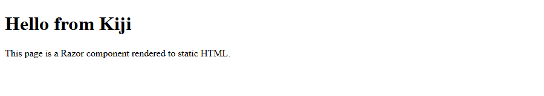
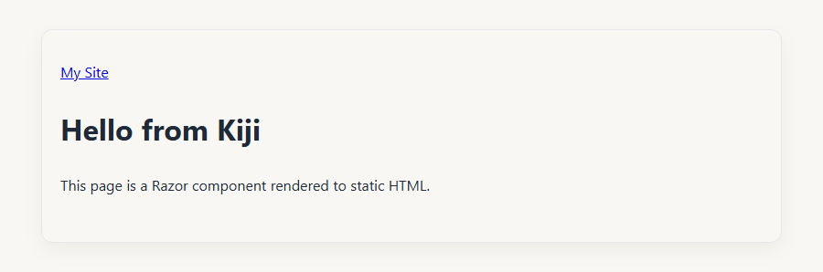
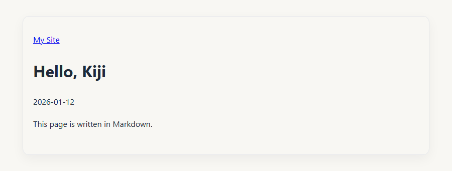
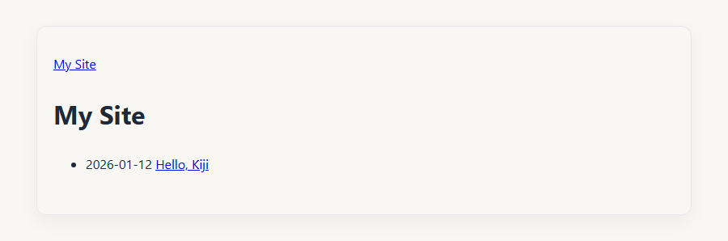

Start with the Blog template for a ready-to-customize site, or follow the walkthrough below to build a minimal blog from scratch.

## Start from a template

[Kiji.Templates](https://github.com/zzzkan/Kiji.Templates) provides templates for
`dotnet new`. Install the package and create a site with the
[Blog template](https://github.com/zzzkan/Kiji.Templates#kiji-blog):

```pwsh
dotnet new install Kiji.Templates
dotnet new kiji-blog -o MyBlog
cd MyBlog
```

Edit `SiteInfo` in `Program.cs` to set the site name, description, language, and
author. Set `BaseUrl` to your public URL, including any deployment subpath such as
`https://example.com/blog/`.

### Preview and customize

Start the development server:

```pwsh
dotnet watch
```

Open <http://localhost:8080>. If you chose a base URL with a subpath, open that path
instead, for example <http://localhost:8080/blog/>.

The Blog template includes dated Markdown posts, an article list, About and Policy
pages, shared styles, syntax highlighting, and RSS.

- Edit posts in `content/posts/<slug>/index.md`. Each post has `title`, `description`,
  and `date` fields in its YAML front matter. Copy a sample post into a new directory
  to add another post; its directory name becomes the slug in `/posts/<slug>/`.
- Edit general pages in `content/pages/`.
- Customize the Razor components in `Pages/`, `Layout/`, and `Components/`, and the
  stylesheet in `wwwroot/css/app.css`.
- Update the site name, public URL, description, language, and author in `Program.cs`.

The server reloads the browser as you edit files.

### Publish the blog

Stop the development server with `Ctrl+C`, then publish:

```pwsh
dotnet publish
```

Upload the contents of `dist/` to your static host. See [Deployment](../deployment/)
for hosting and subpaths. You can now customize the template, or continue below to
learn how the core pieces fit together.

## Build from scratch

This walkthrough builds the core of the Blog template: a home page listing dated
Markdown posts, individual post pages, and a shared layout and stylesheet.
Kiji is a library, so the project uses the usual `dotnet` commands throughout.

Razor and C# examples show complete files. Highlighted lines mark additions or changes.

### Create the project

Create a console project and add the package:

```pwsh
dotnet new console -o MySite
cd MySite
dotnet add package Kiji
```

Open `MySite.csproj` and change its first line to use the Razor SDK:

{data-line="1"}

```xml
<Project Sdk="Microsoft.NET.Sdk.Razor">
```

### Build the smallest site

Replace `Program.cs` with the site definition:

```csharp
using Kiji;

var app = StaticSite.Create(args);
app.Info = new SiteInfo
{
    BaseUrl = new Uri("https://example.com/"),
    Name = "My Site",
};

app.AddPages();

return await app.RunAsync();
```

Create `Pages/Home.razor`:

```razor
@page "/"

<h1>Hello from Kiji</h1>
<p>This page is a Razor component rendered to static HTML.</p>
```

`AddPages()` finds public components with fixed `@page` routes. Start the
development server:

```pwsh
dotnet watch
```

Open <http://localhost:8080>.



The server reloads the browser when you change a component
or content file.

### Add a layout and CSS

Files under `wwwroot/` are static assets. Create `wwwroot/css/app.css`:

```css
body {
  max-width: 48rem;
  margin: 2rem auto;
  padding: 2rem 1.25rem;
  font-family: "Segoe UI", system-ui, sans-serif;
  line-height: 1.7;
  color: #1f2937;
  background: #f8f7f3;
  border: 1px solid #e5e7eb;
  border-radius: 0.75rem;
  box-shadow: 0 8px 24px rgba(15, 23, 42, 0.05);
}
```

Create `Components/PageHead.razor` for the page title:

```razor
@using Kiji
@using Kiji.Components
@inject SiteInfo Site

<StaticHeadContent>
    <title>@Title - @Site.Name</title>
</StaticHeadContent>

@code {
    [Parameter] public string Title { get; set; } = string.Empty;
}
```

Create `Layout/MainLayout.razor` for the shared head tags and page structure:

```razor
@using Kiji
@using Kiji.Components
@inherits LayoutComponentBase
@inject SiteInfo Site

<StaticHeadContent>
    <meta charset="utf-8" />
    <meta name="viewport" content="width=device-width, initial-scale=1.0" />
    <link rel="stylesheet" href="@Assets["css/app.css"]" />
</StaticHeadContent>

<header>
    <a href="@Site.BaseUrl.AbsolutePath">@Site.Name</a>
</header>

<main>
    @Body
</main>
```

Update `Program.cs` to import the layout namespace and register the layout:

{data-line="2,11"}

```csharp
using Kiji;
using MySite.Layout;

var app = StaticSite.Create(args);
app.Info = new SiteInfo
{
    BaseUrl = new Uri("https://example.com/"),
    Name = "My Site",
};

app.UseDefaultLayout<MainLayout>();
app.AddPages();

return await app.RunAsync();
```

Add `PageHead` to `Pages/Home.razor`:

{data-line="2,4"}

```razor
@page "/"
@using MySite.Components

<PageHead Title="Home" />

<h1>Hello from Kiji</h1>
<p>This page is a Razor component rendered to static HTML.</p>
```

Use `PageHead` once in each page for its title. `MainLayout` supplies
the shared head tags. Kiji combines both `StaticHeadContent` contributions in `<head>`.

Stop and restart `dotnet watch`.



`Assets` includes the `BaseUrl` path in the stylesheet URL, so the same markup works at a
domain root and under a deployment sub-path such as GitHub Pages.

### Add a Markdown page

Create `Models/PostFrontMatter.cs` to define the YAML fields your posts use:

```csharp
namespace MySite.Models;

public sealed class PostFrontMatter
{
    public string Title { get; set; } = string.Empty;
    public string Description { get; set; } = string.Empty;
    public DateTimeOffset? Date { get; set; }
}
```

Create `content/posts/hello-kiji/index.md`:

```markdown
---
title: Hello, Kiji
description: The first post on my site.
date: 2026-01-12T09:00:00Z
---

This page is written in Markdown.
```

Create `Models/BlogPost.cs` to represent a post. It exposes the metadata and URL
used by pages and keeps the Markdown content for rendering the body:

```csharp
using Kiji.Markdown;

namespace MySite.Models;

public sealed record BlogPost(
    string Slug, string Title, string Description, DateTimeOffset Date,
    MarkdownContent<PostFrontMatter> Content)
{
    public string RelativePath => $"posts/{Uri.EscapeDataString(Slug)}/";

    public static BlogPost Create(MarkdownContent<PostFrontMatter> content)
    {
        if (string.IsNullOrWhiteSpace(content.FrontMatter.Title) || content.FrontMatter.Date is null)
        {
            throw new InvalidOperationException($"{content.FileInfo.FullName}: posts require a title and date.");
        }

        return new BlogPost(content.FileInfo.Directory!.Name,
            content.FrontMatter.Title, content.FrontMatter.Description,
            content.FrontMatter.Date.Value, content);
    }
}
```

This walkthrough uses one directory per post, with its Markdown in `index.md`.
`BlogPost.Create` uses that directory name as the slug and requires a title and date.

Create `Pages/Post.razor`. `Slug` supplies the route value, while `ContentKey` tells the component which Markdown item to render:

```razor
@page "/posts/{Slug}/"
@using Kiji
@using MySite.Components
@using MySite.Models
@inject ContentDictionary<BlogPost> Posts

@if (_post is not null)
{
    <PageHead Title="@_post.Title" />

    <article>
        <h1>@_post.Title</h1>
        <time datetime="@_post.Date.ToString("yyyy-MM-dd")">@_post.Date.ToString("yyyy-MM-dd")</time>
        <div>@((MarkupString)_html)</div>
    </article>
}

@code {
    [Parameter] public string Slug { get; set; } = string.Empty;
    [Parameter] public string ContentKey { get; set; } = string.Empty;

    private BlogPost? _post;
    private string _html = string.Empty;

    protected override async Task OnParametersSetAsync()
    {
        _post = Posts[ContentKey];
        _html = await _post.Content.RenderAsync();
    }
}
```

Add the required namespaces and registrations to `Program.cs`:

{data-line="2-3,5-6,15-16,19-21"}

```csharp
using Kiji;
using Kiji.Markdown;
using Microsoft.Extensions.DependencyInjection;
using MySite.Layout;
using MySite.Models;
using MySite.Pages;

var app = StaticSite.Create(args);
app.Info = new SiteInfo
{
    BaseUrl = new Uri("https://example.com/"),
    Name = "My Site",
};

app.UseMarkdownContent<PostFrontMatter, BlogPost>(BlogPost.Create,
    options => options.Directory = "content/posts");
app.UseDefaultLayout<MainLayout>();
app.AddPages();
app.AddPages<Post>(services => services
    .GetRequiredService<ContentDictionary<BlogPost>>()
    .Select(post => new { post.Value.Slug, ContentKey = post.Key }));

return await app.RunAsync();
```

`UseMarkdownContent<PostFrontMatter, BlogPost>` calls `BlogPost.Create` for each
Markdown item and makes a `ContentDictionary<BlogPost>` available through dependency
injection. The route registration uses each post's `Slug` and the dictionary key
to generate its page in `/posts/<slug>/`.

Open <http://localhost:8080/posts/hello-kiji/> to see the Markdown post.



### List the posts

Replace `Pages/Home.razor` with a list of posts, newest first:

```razor
@page "/"
@using Kiji
@using MySite.Components
@using MySite.Models
@inject SiteInfo Site
@inject ContentDictionary<BlogPost> Posts

<PageHead Title="Home" />

<h1>@Site.Name</h1>
<ul>
    @foreach (var post in Posts.Values.OrderByDescending(post => post.Date))
    {
        <li>
            <time datetime="@post.Date.ToString("yyyy-MM-dd")">@post.Date.ToString("yyyy-MM-dd")</time>
            <a href="@Site.ResolveUrl(post.RelativePath).AbsolutePath">@post.Title</a>
        </li>
    }
</ul>
```

Return to <http://localhost:8080> to see the post list.



To add another post, create
`content/posts/second-post/index.md` with a title, description, date, and Markdown body.
It will appear in the list and have its own page at `/posts/second-post/`.

Both pages use the same `BlogPost` model: the home page lists its metadata, while
the post page renders its Markdown body.

### Publish the site

Stop the development server and publish:

```pwsh
dotnet publish
```

`dist/` now contains the generated HTML and `css/app.css`. It contains no .NET runtime or server application, so you can upload it to any static host.

Subsequent publishes can reuse unchanged pages automatically. Keep `.kiji/cache` to
preserve that work between builds.
See [Incremental builds](../incremental-builds/) for dependencies and CI caching.

The project now has this shape:

```text
MySite/
├── Layout/
│   └── MainLayout.razor
├── Components/
│   └── PageHead.razor
├── Pages/
│   ├── Home.razor
│   └── Post.razor
├── Models/
│   ├── PostFrontMatter.cs
│   └── BlogPost.cs
├── content/
│   └── posts/
│       └── hello-kiji/
│           └── index.md
├── wwwroot/
│   └── css/
│       └── app.css
├── MySite.csproj      the Razor SDK project with a Kiji package reference
├── Program.cs        the site definition
├── .kiji/            build cache and development output
└── dist/             published output
```

Add `dist/` and `.kiji/` to `.gitignore`. Continue with [Concepts](../concepts/) for the overall model, [Routing](../routing/) for more URL patterns, or [Deployment](../deployment/) when you are ready to host the site.
